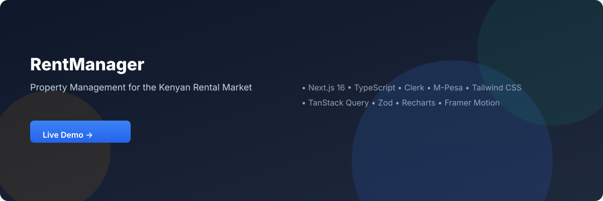
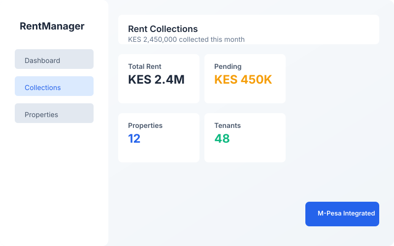
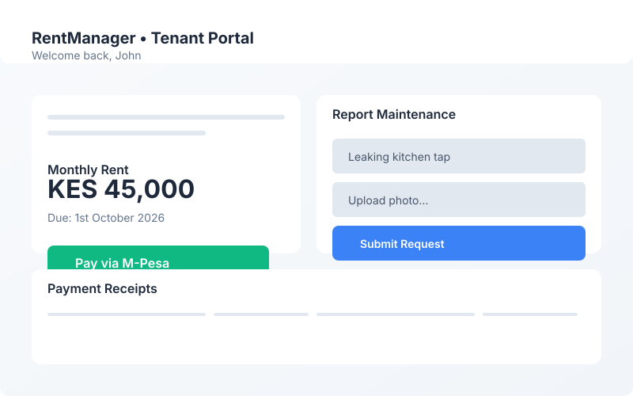
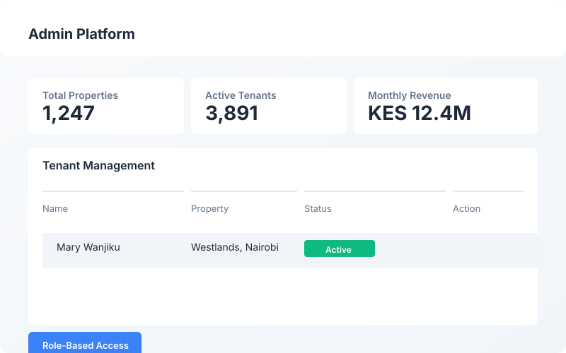
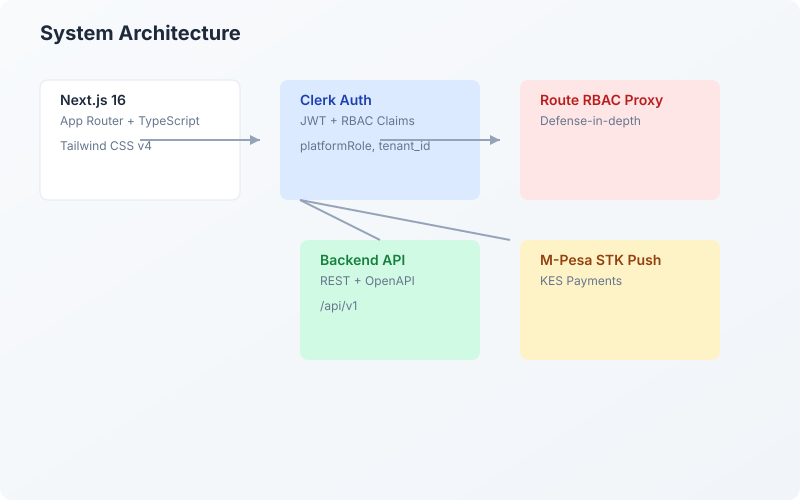

# RentManager Frontend

<p align="center">
  <a href="https://rentmanager-frontend.vercel.app" target="_blank">
    
  </a>
</p>

<p align="center">
  <a href="https://rentmanager-frontend.vercel.app" target="_blank">
    
  </a>
  <a href="https://github.com/hassan200503/rentmanager-frontend/blob/main/LICENSE">
    
  </a>
  <a href="https://github.com/hassan200503/rentmanager-frontend/commits/main">
    
  </a>
  <a href="https://github.com/hassan200503/rentmanager-frontend/issues">
    
  </a>
  <a href="https://github.com/hassan200503/rentmanager-frontend/stargazers">
    
  </a>
  <a href="https://github.com/hassan200503/rentmanager-frontend/network/members">
    
  </a>

## 📸 Screenshots

<p align="center">
  
  
</p>

<p align="center">
  
  
</p>

> 🎬 **Coming soon:** End-to-end demo GIF (property listing → booking → M-Pesa payment → landlord receipt)

---

## 🛠 Tech Stack

| Layer | Technology | Purpose |
|-------|-----------|---------|
| **Framework** | Next.js 16 (App Router) | Production React framework with server components |
| **Language** | TypeScript 5 | End-to-end type safety |
| **Styling** | Tailwind CSS v4 + PostCSS | Utility-first styling |
| **Authentication** | Clerk (@clerk/nextjs) | JWT sessions, role-based access |
| **Data & Caching** | @tanstack/react-query | Server state management |
| **Forms** | react-hook-form + zod | Form handling with schema validation |
| **State** | zustand | Lightweight client state |
| **Charts** | recharts, three.js + @react-three/* | Data visualization & 3D |
| **Motion** | framer-motion, gsap, lenis | Smooth animations & scroll |
| **Notifications** | sonner | Toast notifications |
| **Testing** | vitest (unit), Playwright (e2e) | Unit & end-to-end testing |
| **Deployment** | Docker, Netlify, Cloudflare/OpenNext, Node | Multi-platform deploy |

---

## 🏗 Architecture at a Glance


- **`src/app/layout.tsx`** — Global providers & metadata composition
- **`src/app/(app)/layout.tsx`** — Authenticated route boundary with Clerk providers
- **`src/proxy.ts`** — Route-level RBAC proxy translating Clerk session claims into policy decisions
- **`src/lib/rbac/route-policy.ts`** — Access policy enforcement
- **`src/lib/config/validation.ts`** — Zod-based environment validation (fails fast on invalid config)
- **`src/features/*`** — Domain modules: renter, landlord, maintenance, lease, property, tenant, admin
- **`src/shared/`** — Reusable UI components

This design enforces **performance** (public pages stay small), **security** (guard before rendering), and **type safety** (OpenAPI-driven client types).

---

## 📁 Repository Layout

```
rentmanager-frontend/
├── LICENSE                          # MIT License
├── SECURITY.md                      # Responsible disclosure policy
├── CONTRIBUTING.md                  # Contribution workflow
├── README.md                        # You are here
├── .env.example                     # Environment variable template
├── .github/workflows/ci.yml         # CI/CD pipeline (tests, lint, build)
├── assets/                          # Visual assets for README
├── Dockerfile                       # Container deployment
├── netlify.toml                     # Netlify deployment config
├── wrangler.jsonc                   # Cloudflare/OpenNext config
├── open-next.config.ts              # OpenNext configuration
├── tailwind.config.js               # Tailwind CSS config
├── tsconfig.json                    # TypeScript config
├── vitest.config.ts                 # Vitest configuration
├── src/
│   ├── app/                         # Next.js App Router (pages, layouts, API routes)
│   ├── features/                    # Domain feature modules
│   ├── providers/                   # Query, theme & other providers
│   ├── lib/                         # Auth, RBAC, API clients, config, utilities
│   └── shared/                      # Shared UI components
├── public/                          # Static assets
└── .github/                         # GitHub configs & workflows
```

---

## 🚀 Quick Start (Developer)

### Prerequisites

- Node.js 20+
- npm or pnpm
- A Clerk account (free tier)
- A backend API (or use the mock/development API)

### Installation

---

## ⚙️ Environment Variables

See `.env.example` for the full list. The most critical values:

| Variable | Required | Description |
|----------|----------|-------------|
| `NEXT_PUBLIC_API_URL` | ✅ Yes | Base API origin, must include `/api/v1` suffix |
| `NEXT_PUBLIC_CLERK_PUBLISHABLE_KEY` | ✅ Yes | Clerk publishable key |
| `CLERK_SECRET_KEY` | ✅ Yes | Clerk secret key (server-side only) |
| `NEXT_PUBLIC_APP_URL` | ⚠️ Recommended | Your app's public URL |
| `NEXT_PUBLIC_SENTRY_DSN` | ❌ Optional | Enable Sentry error tracking |

> ⚠️ `NEXT_PUBLIC_*` variables are public at build-time. Keep sensitive keys (`CLERK_SECRET_KEY`, `STRIPE_SECRET_KEY`, webhook secrets) in your hosting provider's secret manager.

---

## 🏃 Running Locally

```bash
# Development
npm run dev

# Type check
npx tsc --noEmit

---

## 🚀 Deployment Options

RentManager is configured for multiple deployment targets:

### Option 1: Vercel (Recommended — One Click)

[](https://vercel.com/new/clone?repository-url=https://github.com/hassan200503/rentmanager-frontend)

1. Connect your GitHub repository to Vercel
2. Add environment variables in the Vercel dashboard
3. Deploy — automatic builds on every push

### Option 2: Docker

```bash
docker build -t rentmanager-frontend .
docker run -p 3000:3000 --env-file .env.production rentmanager-frontend
```

### Option 3: Netlify

```bash
# The netlify.toml is pre-configured
netlify deploy --prod
```

---

## 🧪 Testing & CI

| Command | Purpose |
|---------|---------|
| `npm test` | Run unit tests (Vitest) |
| `npm run lint` | Run ESLint |
| `npx tsc --noEmit` | TypeScript type check |
| `npm run build` | Production build |

**CI Pipeline:** GitHub Actions runs type check, lint, tests, and production build on every push to `main` and every pull request.

Playwright is included in `devDependencies` for end-to-end testing — add CI jobs to run it if you include e2e tests.

---

## 🔒 Security Notes

- **Do not commit secrets.** Keep server-only keys in your hosting provider's secret manager.
- **`src/proxy.ts`** enforces RBAC as a defense-in-depth measure; critical authorization must still be verified by the backend API.
- **Environment validation** uses Zod to fail fast on invalid or missing runtime configuration.
- **Clerk JWT templates** carry platform claims (`platformRole`, `tenant_id`) for backend validation.

See [`SECURITY.md`](SECURITY.md) for responsible disclosure guidance.

---

## 🤝 Contributing & Recruiter Guidance

This repository is arranged to be **recruiter-friendly**: clear architecture, typed API contracts, environment validation, multiple deployment configs, and CI/CD.

Before opening a PR:
- Run `npx tsc --noEmit`
- Run `npm test` and `npm run lint`
- Include a short description, testing steps, and **screenshots/GIFs for UI changes**

See [`CONTRIBUTING.md`](CONTRIBUTING.md) for the full workflow.

---

## 💰 Monetization & Pricing

RentManager is designed as a **SaaS product** with clear revenue streams:

### Pricing Tiers (KES)

| Tier | Price/Month | Properties | Features |
|------|------------|------------|----------|
| **Free** | KES 0 | 1 | Basic dashboard, manual rent tracking |
| **Starter** | KES 2,999 | Up to 5 | M-Pesa integration, digital receipts, email notifications |
| **Pro** | KES 7,999 | Unlimited | Maintenance tracking, admin dashboard, priority support, reports |
| **Enterprise** | Custom | Unlimited | White-label, on-premise, SLA, custom integrations |

### Revenue Opportunities

- **Subscription fees** from landlords and property managers
- **Transaction fees** on M-Pesa payments (negotiable with payment processor)
- **Premium features** (advanced reporting, API access, white-labeling)
- **Custom development** for estate agents and property management companies

---

## 🇰🇪 Built for Kenya

RentManager is designed with the Kenyan market in mind:

- **M-Pesa STK Push integration** — the dominant mobile money platform in Kenya
- **KES currency formatting** — proper Kenyan Shilling display throughout
- **Kenyan ID / KRA PIN fields** — compliant with local documentation requirements
- **County tax compliance** — ready for Nairobi, Mombasa, Kisumu, and other county regulations
- **Local hosting** — deploy on Cloudflare Workers for low latency across East Africa

---

## 📞 Hire Me / Work With Me

I'm an advanced full-stack developer specializing in Next.js, TypeScript, and SaaS architecture. RentManager is a live case study of my ability to build production-grade, revenue-ready products.

**Available for:**
- 💼 Full-time software engineering roles
- 🤝 Contract/freelance development
- 🏗 SaaS product development (property management, fintech, proptech)
- 🤖 AI-enabled development and automation

**Contact:**
- **Email:** your-email@example.com
- **LinkedIn:** https://linkedin.com/in/your-profile
- **WhatsApp:** +254 XXX XXX XXX
- **GitHub:** https://github.com/hassan200503
- **Portfolio:** https://your-portfolio.com

---

## 📜 License

MIT — see [`LICENSE`](LICENSE) in the repository root.

---

<p align="center">
  <b>RentManager — Property Management for the Kenyan Rental Market</b><br/>
  Built with ❤️ in Kenya 🇰🇪
</p>

---

## 🔧 Troubleshooting

| Issue | Solution |
|-------|----------|
| 404s on API calls | Ensure `NEXT_PUBLIC_API_URL` ends with `/api/v1` |
| Clerk redirect issues | Validate Clerk keys and `NEXT_PUBLIC_APP_URL` in Clerk dashboard |
| `http` instead of `https` redirects | Verify hosting forwarded-proto headers and `NEXT_PUBLIC_APP_URL` |
| Env validation errors | Read the Zod validation messages in `src/lib/config/validation.ts` |
| Build failures | Run `npx tsc --noEmit` locally to catch type errors |

---

## 📄 Key Files

| File | Purpose |
|------|---------|
| `src/proxy.ts` | Route-level RBAC proxy |
| `src/app/(app)/layout.tsx` | Authenticated route boundary |
| `src/app/layout.tsx` | Global providers & metadata |
| `src/lib/config/validation.ts` | Environment validation logic |
| `src/lib/rbac/route-policy.ts` | Access policy definitions |
| `src/features/*` | Domain feature modules |
| `.github/workflows/ci.yml` | CI/CD pipeline |

### Option 4: Cloudflare / OpenNext

```bash
# Configured via wrangler.jsonc and open-next.config.ts
npx open-next@latest deploy
```

### Option 5: Standard Node Hosting

```bash
npm run build
npm start
```

# Lint
npm run lint

# Tests
npm test

# Build for production
npm run build

# Start production server
npm start
```

```bash
# Clone the repository
git clone https://github.com/hassan200503/rentmanager-frontend.git
cd rentmanager-frontend

# Install dependencies
npm install

# Set up environment variables
cp .env.example .env.local

# Start development server
npm run dev
```

Open [http://localhost:3000](http://localhost:3000) in your browser.

### Get a Test Clerk Account

1. Sign up at [clerk.com](https://clerk.com)
2. Create a new application
3. Copy your **Publishable Key** and **Secret Key** from the dashboard
4. Add them to `.env.local`:

```bash
NEXT_PUBLIC_CLERK_PUBLISHABLE_KEY=pk_test_...
CLERK_SECRET_KEY=sk_test_...
CLERK_WEBHOOK_SIGNING_SECRET=whsec_...
```

5. Configure a JWT template named `backend` with claims like `platformRole` and `tenant_id` if your backend validates them.
  <br/>
  
  
  
  
  
  
</p>

---

## 🏠 Overview

**RentManager** is a production-grade property management platform purpose-built for the Kenyan rental market. It empowers landlords to collect rent, manage properties, and track maintenance — while giving renters a seamless portal to pay via M-Pesa, report issues, and access lease documents.

The frontend is built with **Next.js 16 (App Router)**, **TypeScript**, **Clerk authentication**, and **TanStack Query**, with a route-level RBAC proxy and OpenAPI-driven API typing for enterprise-grade security and type safety.

### Four Personas, One Platform

| Persona | Key Capabilities |
|---------|-----------------|
| **Landlords** | Rent collection, occupancy tracking, leases, maintenance triage, accounting & disbursements |
| **Renters** | M-Pesa payment flows, maintenance reporting, announcements, lease access |
| **Admins** | Platform management, tenant & org oversight, system configuration |
| **Public Visitors** | Marketing pages, property listings, reservation flows |

> Public pages are intentionally isolated from the authenticated shell — Clerk and other heavy bundles are **not loaded** on landing and listing pages, keeping time-to-first-paint under 1 second.