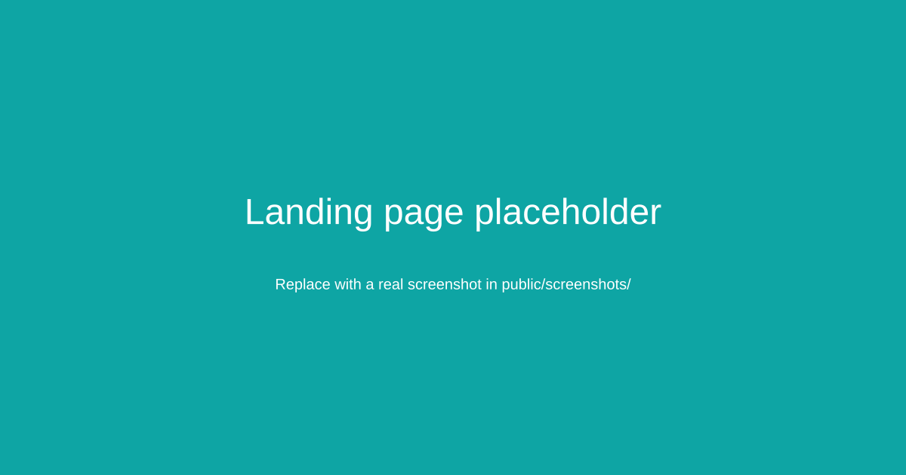
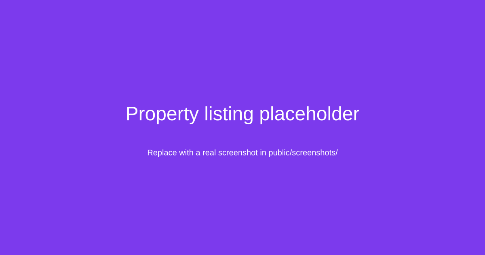
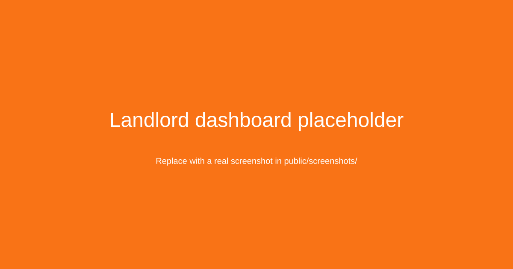
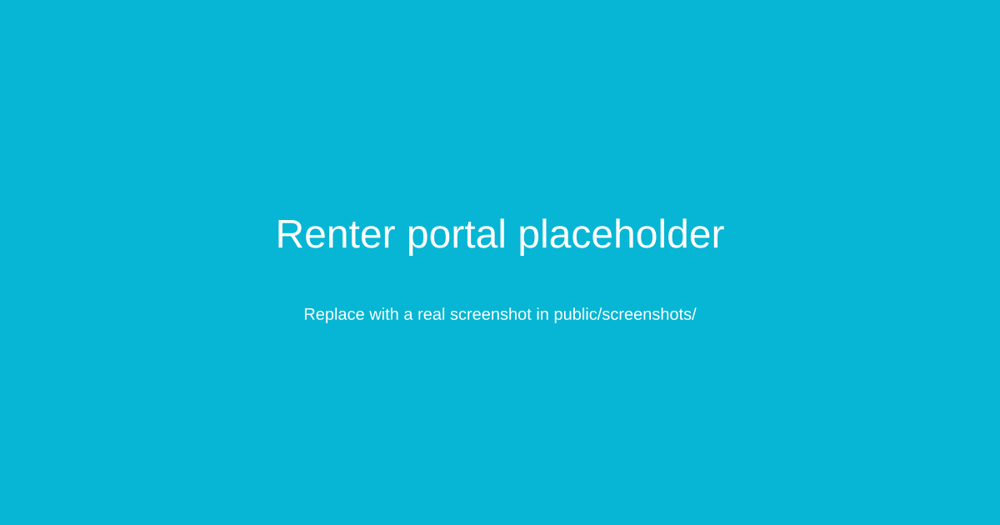
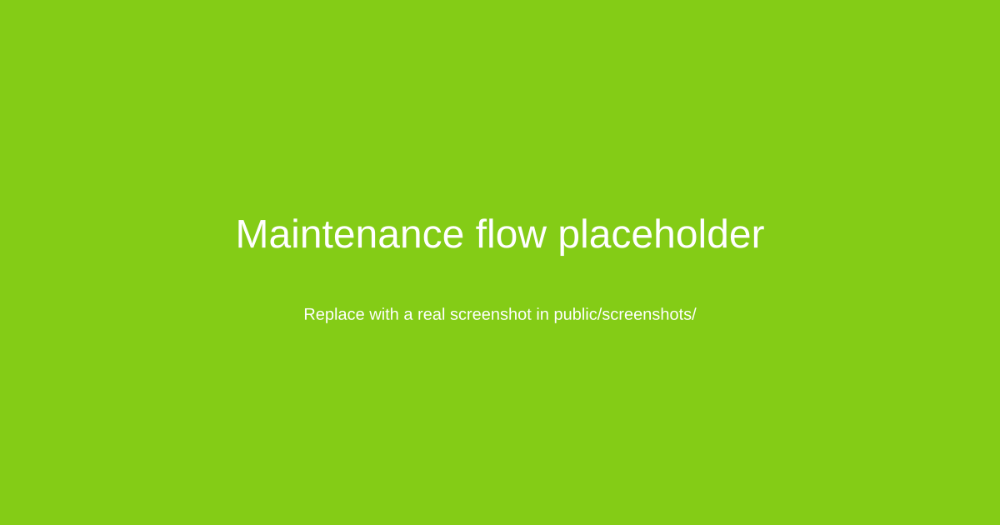
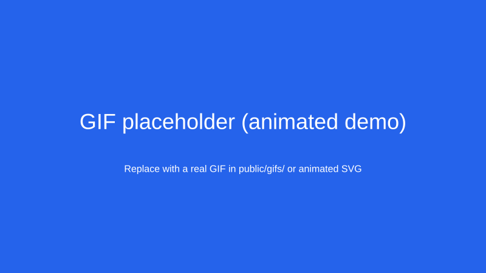

# RentManager Frontend

[](https://github.com/hassan200503/rentmanager-frontend/blob/main/LICENSE)
[](https://github.com/hassan200503/rentmanager-frontend/commits/main)
[](https://github.com/hassan200503/rentmanager-frontend/issues)
[](https://github.com/hassan200503/rentmanager-frontend/stargazers)

RentManager Frontend is a modern property management web application built for Kenya’s rental market. It gives landlords, renters, admins, and public visitors a streamlined experience for managing listings, tenancy workflows, payments, maintenance, and communication.

Built with Next.js, TypeScript, Clerk, Tailwind, and a domain-driven feature structure, the app is designed for clarity, performance, and operational scalability.

## Why this project matters

RentManager addresses a common problem in property management:
- fragmented communication between landlords and tenants
- poor visibility into occupancy, payments, and maintenance
- manual workflows for rent collection and issue triage
- weak operational control for property managers and admins

This frontend provides a responsive, secure, and production-ready experience for those workflows while integrating with a backend API and modern auth controls.

---

## Live demo

Demo URL: https://your-demo-url.example.com

If you deploy the app, add a real live URL here and include a short note such as:
- Landlord dashboard
- Renter portal
- Public listing pages
- Maintenance and payment flows

---

## Product overview

### Personas served
- Landlords — manage rent collection, occupancy, leases, maintenance, accounting, disbursements
- Renters — track payments, submit maintenance requests, view announcements and lease data
- Admins — supervise tenants, organizations, account oversight, and operational controls
- Public visitors — browse property listings and submit inquiries

### Core experience
- Public landing pages and listing views
- Secure authenticated app shell
- Role-aware route protection
- Property and tenant management dashboards
- Rent and maintenance workflows
- Payment-ready UX with M-Pesa support
- Modern real estate UX with responsive layouts and animation

---

## Screenshots

### Landing page


### Property listing


### Landlord dashboard


### Renter portal


### Maintenance workflow


> Add screenshots under `public/screenshots/` and keep image sizes optimized for GitHub.

---

## GIF walkthrough



> Add a short 10–20 second product demo GIF or animated SVG to showcase the most important user flow, such as:
- browsing a listing
- logging in
- viewing the dashboard
- submitting a maintenance request
- tracking rent status

---

## Tech stack

- Language: TypeScript
- Framework: Next.js 16 (App Router)
- Styling: Tailwind CSS
- Authentication: Clerk
- Data fetching & cache: TanStack Query
- Forms & validation: React Hook Form + Zod
- State management: Zustand
- Charts: Recharts
- 3D / motion / UX: Three.js, Framer Motion, GSAP, Lenis
- Notifications: Sonner
- Testing: Vitest, Playwright
- Edge deployment: OpenNext / Cloudflare / Netlify
- Container support: Docker

---

## Architecture

The application is organized around a clear feature-based frontend architecture:

- `src/app` — Next.js App Router pages and layouts
- `src/features` — business-aligned domain modules
- `src/lib` — config, auth, RBAC, API utilities, validation
- `src/providers` — app providers and shared setup
- `src/shared` — shared UI and reusable components
- `src/stores` — Zustand state stores
- `src/types` — TypeScript models and types

The app separates public pages from authenticated flows to keep route load times lean and improve performance. Route protection is enforced before rendering sensitive content, and environment validation helps fail early on misconfiguration.

---

## Repository structure

```text
.
├── src/
│   ├── app/
│   ├── features/
│   ├── lib/
│   ├── providers/
│   ├── shared/
│   ├── stores/
│   └── types/
├── public/
│   ├── screenshots/
│   └── gifs/
├── .env.example
├── Dockerfile
├── netlify.toml
├── next.config.ts
├── open-next.config.ts
├── package.json
├── tailwind.config.js
├── tsconfig.json
├── vitest.config.ts
├── wrangler.jsonc
├── README.md
└── ...
```

---

## Getting started

### Prerequisites
- Node.js 18+
- npm
- Access to a backend API
- Clerk account with valid development keys

### Installation

```bash
git clone https://github.com/hassan200503/rentmanager-frontend.git
cd rentmanager-frontend
npm install
cp .env.example .env.local
```

Then update `.env.local` with your actual values.

### Required environment variables

Example:

```bash
NEXT_PUBLIC_API_URL=https://your-api.example.com/api/v1
NEXT_PUBLIC_CLERK_PUBLISHABLE_KEY=pk_test_xxx
CLERK_SECRET_KEY=sk_test_xxx
NEXT_PUBLIC_APP_URL=http://localhost:3000
```

> Keep sensitive values server-side and never commit secrets.

### Run locally

```bash
npm run dev
```

Open:

```text
http://localhost:3000
```

---

## Production build

```bash
npm run build
npm start
```

For production hosting, configure environment variables in your deployment platform and ensure the API URL is correct.

---

## Testing

```bash
npm test
npm run lint
npx tsc --noEmit
```

For client validation, use Vitest for unit tests and extend the project with Playwright E2E coverage as the app grows.

---

## Deployment

This project supports multiple deployment targets:
- Docker
- Netlify
- Cloudflare / OpenNext
- Standard Node hosting

Configure provider secrets and runtime environment values before deployment.

---

## Security

- Never commit secrets or private keys
- Keep Clerk and webhook secrets in your hosting platform secret store
- Rely on backend validation for critical authorization decisions
- Use route protection and config validation as defense-in-depth layers

For responsible disclosure or security concerns, use the project’s disclosure process if available.

---

## Contributing

Contributions are welcome. Please open a pull request with:
- a clear description of the problem or feature
- screenshots or GIFs for UI changes
- testing notes
- any relevant configuration updates

Before merging:
- run lint
- run tests
- confirm build passes
- review the app in a browser

---

## Roadmap / future enhancements

- stronger onboarding flows
- richer analytics and reporting
- tenant communication improvements
- expanded payment workflows
- deeper audit logging and reporting
- stronger deployment automation

---

## License

MIT

---

## Important repo maintenance note

For a polished GitHub presence, also ensure:
- `LICENSE` exists at the repo root
- `SECURITY.md` exists if referenced
- screenshot and GIF assets are committed into `public/screenshots` and `public/gifs`
- the main branch is protected
- CI checks run before merge

---

## PR instructions (what I changed and next actions)

Files added/updated on this branch `docs/readme-complete`:
- README.md (this file) — polished content and asset references
- LICENSE — MIT license file
- SECURITY.md — basic security guidance
- placeholder assets under `public/screenshots` and `public/gifs`

What you should do next:
1. Review this branch and verify screenshots/GIFs or replace the placeholder assets with real images.
2. Open a PR: https://github.com/hassan200503/rentmanager-frontend/compare/main...docs/readme-complete?expand=1
3. Review the PR, request changes if needed, then merge.
4. Apply branch protection to `main` (I can provide exact JSON or UI steps if you want them).